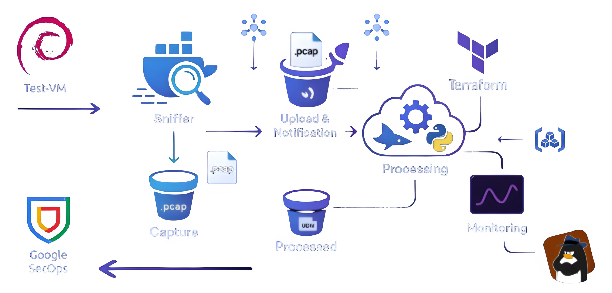

# Chronicle-Sniffer  
<p align="left">
  <a href="https://cloud.google.com/" target="_blank"></a>
  <a href="https://www.terraform.io/" target="_blank"></a>
  <a href="https://www.docker.com/" target="_blank"></a>
  <a href="https://www.python.org/" target="_blank"></a>
  <a href="https://www.wireshark.org/docs/man-pages/tshark.html" target="_blank"></a>
  <a href="LICENSE"></a>
  <a href="https://hub.docker.com/r/fillol/chronicle-sniffer" target="_blank"></a>
</p>

**Author:** [Filippo Lucchesi](https://github.com/fillol)  
**Course:** [Scalable and Reliable Services](https://www.unibo.it/en/study/course-units-transferable-skills-moocs/course-unit-catalogue/course-unit/2024/472686), [University of Bologna](https://www.unibo.it)  
**Evolution of:** [Wireshark-to-Chronicle-Pipeline](https://github.com/fillol/Wireshark-to-Chronicle-Pipeline)  

## 📖 Overview

Chronicle-Sniffer implements a robust, event-driven pipeline to capture network traffic using `tshark`, process it, and transform it into the **Unified Data Model (UDM)** format for security analytics. 

Evolving from a local batch-processing script, this project is a fully cloud-native, serverless solution orchestrated on Google Cloud Platform (GCP) via Terraform. It is designed to handle massive network captures efficiently, shifting the heavy computational lifting from on-premises hardware to the cloud.

## 🏗️ Architecture

The system employs a distributed, decoupled architecture:

1. **Capture & Notify (Edge):** A Dockerized `tshark` sniffer captures packets, rotates PCAP files, uploads them to Google Cloud Storage (GCS), and triggers a Pub/Sub notification.
2. **Trigger & Process (GCP):** A Cloud Run service is invoked by Pub/Sub. It downloads the PCAP, converts it to raw JSON via an embedded `tshark` instance, and processes it into UDM format.
3. **Store & Monitor (GCP):** The final UDM JSON is stored in an output GCS bucket. Cloud Logging and Cloud Monitoring track the pipeline's health, latency, and error rates via a custom Terraform-deployed dashboard.



## ✨ Key Technical Features

* **Streaming JSON Parsing:** The core engine (`json2udm_cloud.py`) uses `ijson` to stream and parse massive `tshark` outputs packet-by-packet. This drastically reduces the memory footprint and eliminates OOM (Out-of-Memory) errors in resource-constrained environments like Cloud Run.
* **Serverless Scalability:** Uses GCP Cloud Run for demanding PCAP-to-UDM transformations, triggered automatically by Pub/Sub, decoupling capture from processing.
* **Infrastructure as Code (IaC):** The entire GCP infrastructure (Buckets, Pub/Sub topics, DLQs, Cloud Run, IAM, and Dashboards) is provisioned and managed via **Terraform**.
* **Observable System:** Deep integration with Cloud Logging and a custom operational dashboard (defined via MQL) to track system health, DLQ messages, latency, and processing error rates.

## 📂 Repository Layout

* **[`docs/`](./docs/)**: Technical report (LaTeX/PDF), presentation slides, and the **[Setup guide](./docs/README.md)**.
* **[`terraform/`](./terraform/)**: IaC modules (GCS, Pub/Sub, Cloud Run, Dashboards, Test VM)
* **[`sniffer/`](./sniffer/)**: On-Premises/Edge Sniffer component (Docker, entrypoint script)
* **[`processor/`](./processor/)**: Cloud Run Processor (Flask app, core UDM streaming script)
* **[`test/`](./test/)**: Sample PCAPs, expected UDM outputs, and manual testing guides

## 🚀 Getting Started

For detailed configuration, IAM roles, and prerequisites, see the **[Extended Documentation (`docs/README.md`)](./docs/README.md)**.

### 1. Prep & Authenticate
Login and set up Application Default Credentials for Terraform
```bash
gcloud auth login
gcloud auth application-default login
gcloud auth configure-docker REGION-docker.pkg.dev
```

### 2. Build & Push Processor
*(Skip if using a pre-built public image)*
```bash
# Build and push the processor to your Artifact Registry
docker build -t REGION-docker.pkg.dev/PROJECT_ID/REPO/pcap-processor:latest ./processor
docker push REGION-docker.pkg.dev/PROJECT_ID/REPO/pcap-processor:latest
```

### 3. Deploy Infrastructure (Terraform)
Initialize and deploy the GCP environment
```bash
terraform init -reconfigure
terraform plan -out=tfplan.out
terraform apply tfplan.out
```

### 4. Run the Edge Sniffer
```bash
# 1. Generate the Service Account key (running Terraform from its directory)
$(terraform -chdir=terraform output -raw generate_sniffer_key_command)

# 2. Setup the key for the Docker mount
mkdir -p sniffer/gcp-key && cp sniffer-key.json sniffer/gcp-key/key.json

# 3. Launch the sniffer using the specific compose file
docker compose -f sniffer/compose.yml up --build -d
```